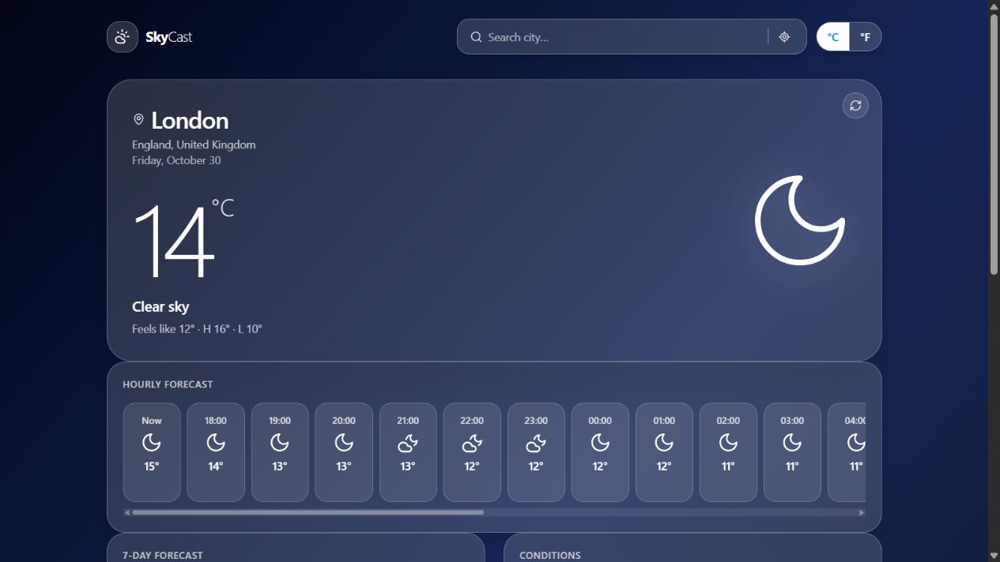

# SkyCast Weather

A responsive weather dashboard for exploring current conditions, hourly forecasts, a seven-day outlook and air quality.

**[Open live demo](https://skycast-weather-adarsh271402.netlify.app)** · [Features](#features) · [Run locally](#run-locally)

**Next.js · React · TypeScript · Tailwind CSS · Open-Meteo**

## Preview



*Captured from the live application on 30 October 2026.*

## Features

- Search for a city and revisit up to five recent locations.
- View current temperature, feels-like temperature, humidity, wind, pressure and visibility.
- Explore hourly and seven-day forecasts.
- Switch between Celsius and Fahrenheit; preferences are saved in the browser.
- View sunrise, sunset, moon phase and air quality when data is available.
- Use browser location with permission, or search manually.
- Weather-dependent backgrounds, loading states and retry controls.

## How it works

The React interface calls Next.js API routes for weather and location data. Open-Meteo supplies weather data; the browser stores the last selected location, recent searches and temperature units.

## Run locally

Use a Node.js version supported by the project's Next.js 16 dependency, such as Node.js 22 LTS, and npm.

```sh
git clone https://github.com/Adarsh271402/weather-app.git
cd weather-app
npm install
npx next dev -p 3000
```

Open [localhost:3000](http://localhost:3000). Search for a city if location access is unavailable.

## Project structure

| Path | Purpose |
| --- | --- |
| `src/app/page.tsx` | Weather dashboard and saved preferences |
| `src/app/api/` | Weather and location API routes |
| `src/components/weather/` | Forecast, conditions, sun/moon and air quality components |
| `src/lib/weather.ts` | Weather types, labels and formatting |
| `netlify.toml` | Hosting configuration |

## Checks

```sh
npm run lint
npx next build
```

These commands run linting and a production build. Live weather availability also depends on upstream services.

## Deployment

Hosted on Netlify with Next.js API routes. Build settings are in `netlify.toml`.

After linking this project with the Netlify CLI, publish with:

```sh
npx netlify-cli deploy --prod --context production
```

## Author

[Adarsh Gupta](https://github.com/Adarsh271402) · [Portfolio](https://adarsh-portfolio-yw1d.netlify.app)
